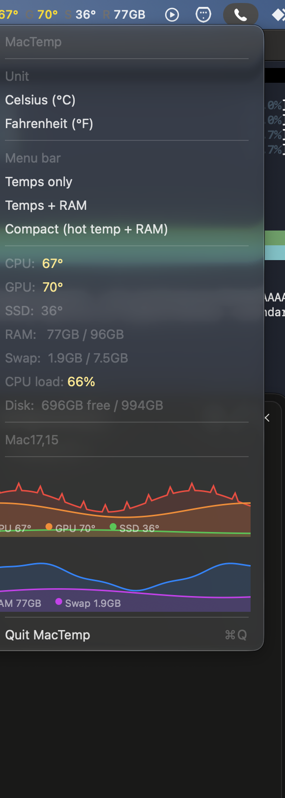

# MacTemp

A lightweight macOS menu bar monitor for Apple Silicon Macs: live **CPU / GPU / SSD temperatures**, **RAM**, **swap**, **CPU load**, **disk space**, **power**, **clock speeds**, **fan RPM**, and **network throughput** — with history graphs, no dependencies, and no sudo for monitoring.

| Menu bar readout | Menu dropdown with live graphs |
|---|---|
|  |  |

## Features

- **Temps, RAM, swap, CPU load, disk, fans, network** in your menu bar, refreshed every 2 s
- **Power & clocks**: CPU/GPU package power (W), CPU max core frequency (MHz), CPU/GPU busy % via IOReport residency — per-tier DVFS tables read straight from `pmgr`
- **Fan control**: **Auto**, **Full Blast**, or a **custom RPM slider** (writes SMC fan targets; macOS authorization prompt required — see Fan control)
- **Fan + network panels** added to the dropdown: now 6 macmon-style panels (CPU / GPU / SSD / RAM / FAN / NET)
- **Threshold alerts**: a macOS notification when CPU/GPU/SSD crosses a configurable °C threshold (5-min cooldown per source)
- **Settings window** (⌘,): °C/°F, menu-bar layout incl. **graph sparkline** mode with selectable metric, refresh interval, alert threshold, **launch at login**, fan controls
- **Menu-bar mini-graph**: sparkline of any metric drawn right into the status item
- **Color-coded**: temps turn **yellow** ≥ 60 °C and **red** ≥ 80 °C; RAM/CPU/disk rows color on pressure, load, and free-space thresholds
- **No dependencies** — pure Swift + a small C helper, built with `swiftc`, no SPM/Xcode project
- **No sudo for monitoring** — reads SMC + IOHID + Mach VM stats directly

## Fan control

MacTemp can override the fan curve: **Full Blast** pins both fans to max RPM, and the custom slider holds them at any target between the hardware min/max. Back to **Auto** restores the system fan control.

- Fan **writes** to the SMC require administrator privileges (reads do not). MacTemp applies fan changes through a bundled `fanctl` helper via macOS's standard authorization prompt — you'll be asked for your password once per change.
- Safety net: if MacTemp quits while fans are manual, it restores Auto first (toggleable in Settings).
- Verified on Mac Studio (Mac17,15, 2 fans, 1000–3625 RPM); other models show whatever `F*Ac/F*Mn/F*Mx` keys report.

## What's monitored

| Metric | Source |
|--------|--------|
| CPU temp | SMC — average of all `Tp*`, `Te*`, `Ts*` keys |
| CPU hottest core | SMC — max single core key |
| GPU temp | SMC — average of all `Tg*` keys |
| SSD temp | IOHID — `NAND CH0` NVMe temperature sensor |
| RAM used | Mach `host_statistics64` (active + inactive + wired + compressed, like Activity Monitor) |
| Swap | `sysctl vm.swapusage` (`xsw_usage`) |
| Memory pressure | `sysctl kern.memorystatus_vm_pressure_level` |
| CPU load | Per-core `PROCESSOR_CPU_LOAD_INFO` tick deltas |
| CPU/GPU power | IOReport AppleCLPC aggregate energy counters (macOS 27) |
| CPU/GPU busy % & MHz | IOReport core/GPU performance-state residencies × `pmgr` DVFS tables |
| Fan RPM / limits | SMC `F*Ac`, `F*Mn`, `F*Mx`, `F*Tg`, `F*md` |
| Network throughput | `getifaddrs` byte-counter deltas (`en*`/`bridge*`) |
| Disk free | `statfs("/")` |

## Install

Homebrew (recommended):

```bash
brew tap rkoh46/mactemp
brew install --cask mactemp
```

Or download `MacTemp.dmg` from the [latest release](../../releases/latest), open it, and drag MacTemp to Applications. The app is ad-hoc signed (not notarized), so on first launch right-click → Open (or `xattr -d com.apple.quarantine /Applications/MacTemp.app`).

To remove the privileged fan helper too (brew uninstall leaves it; it's harmless but persistent):

```bash
sudo launchctl bootout system/local.mactemp.helper
sudo rm /Library/PrivilegedHelperTools/local.mactemp.helper /Library/LaunchDaemons/local.mactemp.helper.plist
```

Or build from source:

```bash
git clone https://github.com/rkoh46/mactemp && cd mactemp
./build.sh install    # builds and installs to /Applications
./build.sh run        # or: build + launch locally
```

Requires Xcode Command Line Tools (`swiftc` + `clang`).

## Building a release DMG

```bash
./release.sh          # builds MacTemp.app and writes dist/MacTemp.dmg
```

## Platform notes

- Tested on: Mac Studio (Mac17,15), macOS 27
- Supported (untested): Apple Silicon Macs that expose SMC temperature keys (M1 and later)
- Power/clock metrics use macOS 27 AppleCLPC energy counters; on other OS versions those fields show `--` while everything else keeps working
- Intel Macs are not supported (different SMC keys; SMC reads require root there)
- The NVMe sensor is found via the HID event system on usage page `0xFF00` (product name contains "NAND")

## Architecture

- **main.swift** — SMC client (`IOServiceOpen("AppleSMC")`), Mach/sysctl samplers, `NSStatusItem` UI, colored menu rows, threshold alerts, login item
- **metrics.swift** — IOReport engine (`libIOReport.dylib` via `dlopen`): CLPC energy channels, CPU/GPU residency → busy %/MHz, `pmgr` DVFS table parsing; `getifaddrs` network sampler
- **ui.swift** — fan controls (bundled `fanctl` helper + `osascript` admin), 6-panel graph grid, menu-bar sparkline, settings window
- **hid_temp.c** → `libhidtemp.dylib` — IOHID reader for the NVMe NAND temperature sensor
- **hidtemp.h** — Swift bridging header for the IOHID library
- **tools/fanctl.swift** — fan read/blast/set/auto CLI (also bundled in the app at `Contents/MacOS/fanctl`)
- **icon_draw.swift** — generates the app icon programmatically (→ `MacTemp.icns`)
- **tools/crop_shots.py** — composites the README screenshots onto dark cards

### Regenerating the screenshots

```bash
MAC_TEMP_SELFTEST=1 MAC_TEMP_DEMO=1 ./MacTemp.app/Contents/MacOS/MacTemp  # captures app-only windows
python3 tools/crop_shots.py                                              # -> assets/*.png
```

`MAC_TEMP_SELFTEST` opens the menu and captures only MacTemp's own windows (the open
menu via `screencapture -l`, the status-item button via AppKit `cacheDisplay`) — no
desktop behind them. `MAC_TEMP_DEMO` seeds a plausible history so the graphs render.
`MAC_TEMP_SETTINGS=1` also opens the Settings window for capture. `MAC_TEMP_DUMP=1`
prints three live samples headlessly.

## Credits

Thermal key enumeration strategy adapted from [vladkens/macmon](https://github.com/vladkens/macmon).
SMC protocol layout from [exelban/stats](https://github.com/exelban/stats).
CLPC energy channel IDs and the residency → usage/frequency math ported from macmon as well.

## License

MIT
